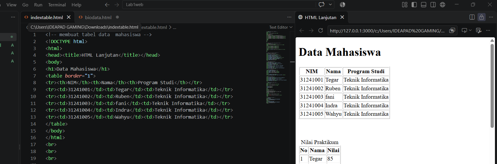
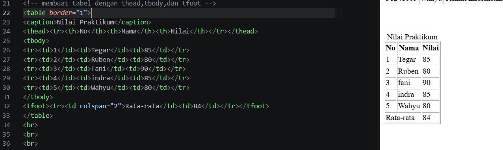
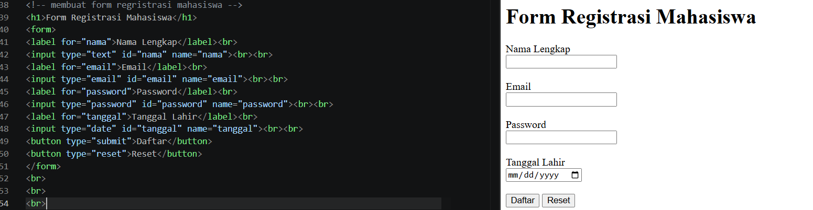
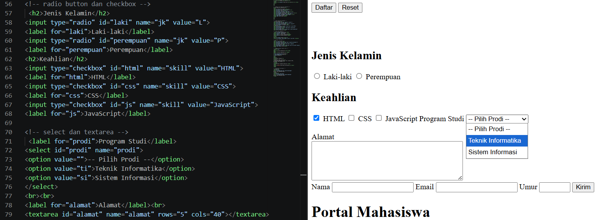
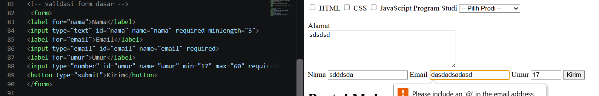
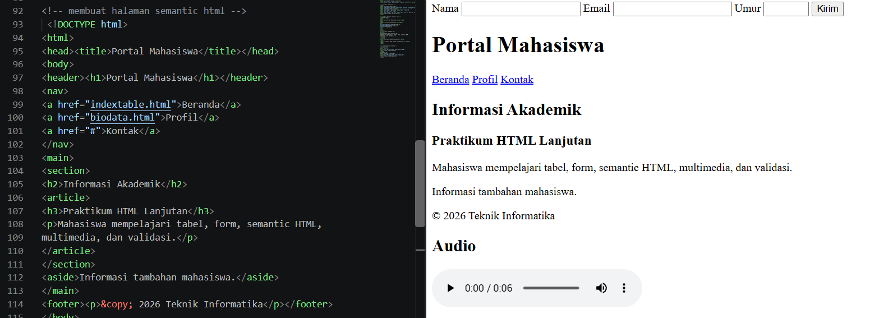
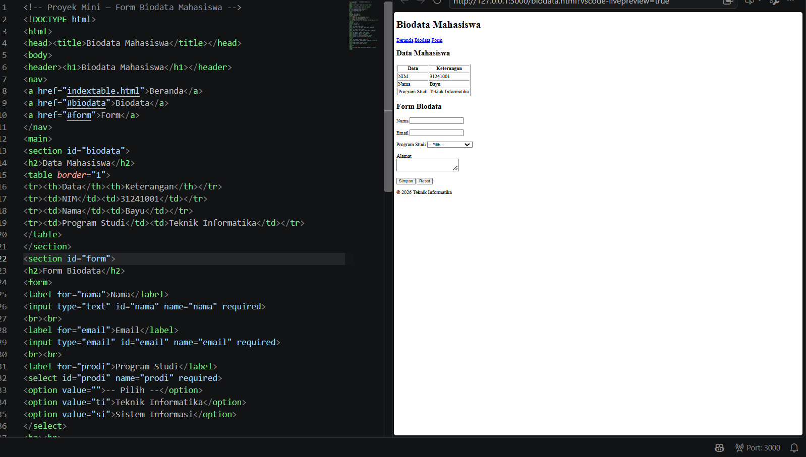

# HTML Lanjutan

## Identitas

**Nama:** Tegar Aldiano Kurniawan  
**NIM:** 312510058  
**Mata Kuliah:** Pemrograman Web  

## Materi yang Dikerjakan

### 1. Membuat Tabel Data Mahasiswa

Menampilkan NIM, nama, dan program studi mahasiswa.



---

### 2. Nilai Praktikum

Membuat tabel nilai menggunakan `thead`, `tbody`, dan `tfoot`.



---

### 3. Form Registrasi Mahasiswa

Membuat form dengan input nama, email, password, dan tanggal lahir.



---

### 4. Radio Button, Checkbox, Select dan Text Area

Membuat pilihan jenis kelamin, keahlian, program studi, dan alamat.



---

### 5. Validasi Halaman Dasar

Menggunakan `required`, `minlength`, `min`, `max`, dan tipe input email.



---

### 6. Semantic HTML

Menggunakan `header`, `nav`, `main`, `section`, `article`, `aside`, dan `footer`.


---

### 7. Menambahkan Multimedia

Menambahkan audio dan video ke dalam halaman HTML.



---

### 8. Proyek Mini Form Biodata Mahasiswa

Membuat halaman biodata mahasiswa yang berisi tabel dan form biodata.



---

## Tools yang Digunakan

- Visual Studio Code
- HTML5
- Live Server
- Web Browser

## File Project

```text
Lab2Web/
│
├── images/
│   ├── tabel.png
│   ├── nilai.png
│   ├── registrasi.png
│   ├── input.png
│   ├── validasi.png
│   ├── semantic.png
│   ├── multimedia.png
│   └── biodata.png
│
├── 01-sound.mp3
├── 02-video.mp4
├── biodata.html
├── indexable.html
└── readme.md